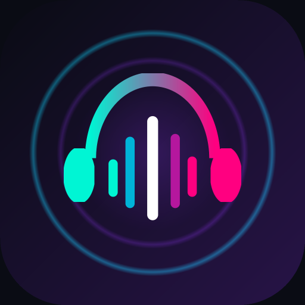

<p align="center">
  
</p>

<h1 align="center">Muesic</h1>

<p align="center">
  <strong>Your music, your device, your privacy.</strong><br>
  A modern, high-fidelity Android streaming music player built with Jetpack Compose & Material 3. Stream millions of tracks at up to 320 kbps with zero ads, zero trackers, and no required accounts or API keys.
</p>

<p align="center">
  
  
  
  
  
  
</p>

---

## 📖 About Muesic

**Muesic** is an independent, client-side open music application designed for listeners who want complete ownership over their listening experience. Unlike conventional streaming services, Muesic requires **no subscriptions, no logins, and no personal data collection**. It connects directly to public music streams (JioSaavn and YouTube / YouTube Music) to deliver crisp 320 kbps audio straight to your headphones, paired with a local Room database to maintain your playlists, play history, and cached songs safely on your device.

---

## ✨ Currently Existing Features

### 🎧 1. Multi-Source Search & Playback
- 🎵 **Direct JioSaavn Streaming**: Instant search and direct streaming of millions of Bollywood, regional (Punjabi, Tamil, Telugu, Malayalam, Bengali), and international tracks at up to **320 kbps** with zero authentication.
- 📺 **Headless YouTube & YouTube Music Engine**: Seamlessly searches and plays tracks from YouTube & YouTube Music in the background with lock screen playback and no video interference.
- 🔍 **Unified Multi-Source Search**: Switch between *All Sources*, *JioSaavn*, *YouTube Music*, and *YouTube* with a single tap, complete with instant search history and auto-suggestions.
- ⬇️ **yt-dlp URL Import**: Select **yt-dlp URL**, paste a supported HTTPS media-page URL, and submit it explicitly to inspect the audio metadata. Choose **Download & play** or **Download audio** and confirm that you have permission and the source allows downloading. Muesic extracts an MP3 and saves it to the system folder selected under **Settings → yt-dlp Downloads**. This is URL-based importing, not a cross-site text-search catalog; support depends on yt-dlp's current extractors and the source's availability.

### 🌟 2. Dynamic Discover & Smart Feeds
- 🔥 **Trending Hits**: Live trending charts continuously populated from online music rankings.
- 🌐 **Top Songs by Dimension**: Filter and browse by:
  - **Language**: Hindi, English, Punjabi, Tamil, Telugu, and more.
  - **Category**: Romance, Party, Workout, Chill, 90's Nostalgia, etc.
  - **Type**: Pop, Hip-Hop, Acoustic, Classical, Indie, EDM.
  - **Artist & Country**: Top releases categorized by creator and region.
- 🎬 **New Releases by Movie / Album**: Grouped soundtrack albums for Indian and global cinema releases.
- 🎙️ **Recommended Artists & Top Mixes**: Dedicated artist spotlights and genre-tailored radio mixes.
- 📜 **Expansive Playlist Detail Screen**: Tapping any playlist or category card opens a full screen with track counts, total duration, artwork, **"Play All"**, and **"Shuffle Play"** buttons.
- 🔄 **Live Auto-Sync & Swipe-to-Refresh**:
  - Pull down anywhere on the Discover screen to trigger a live **Pull-to-Refresh**.
  - Automatically fetches new releases on every app launch and foreground resume.
  - Runs a background ticker every 10 minutes to keep music feeds continuously fresh.

### 🎚️ 3. Audio Processing & Equalizer
- 🎛️ **Built-in 5-Band Equalizer**: Fine-tune frequency bands (60Hz, 230Hz, 910Hz, 3.6kHz, 14kHz).
- 🔊 **Acoustic Presets & Bass Boost**: One-tap presets for Vocal Boost, Bass Heavy, Electronic, Rock, Acoustic, and Flat.
- 🌊 **Real-Time Audio Visualizer**: Elegant waveform feedback that reacts dynamically during active playback.
- ⚡ **ECO Mode vs. Hi-Fi Mode**:
  - **ECO**: Optimized buffer and processing to maximize battery life on low power.
  - **Hi-Fi**: Full dynamic bit-depth rendering for studio headphones and DACs.

### 🔒 4. Privacy, Offline & Local Storage
- 🛡️ **Privacy Shield**: Zero analytics, zero ad SDKs, zero telemetry identifiers.
- 🗄️ **Room Database**: Favorites, custom playlists, and play counters are stored strictly in local SQLite.
- 🧹 **Automatic Playback Cache Cleanup**: Temp audio cache automatically frees memory right after track playback finishes so storage never balloons.
- 💾 **Encrypted Backup & Restore**: Export and import your playlists and configurations via JSON or encrypted ZIP archives.
- 📲 **System Media Controls**: Android 13/14/15 media session notification with play/pause, seekbar, next/previous track, and lock screen artwork.

---

## 🚀 Installation & Setup

### Option 1: Direct APK Installation (Recommended for Users)
1. Download the latest `app-debug.apk` or release APK from the **Releases** section or exported build artifacts.
2. Transfer the `.apk` file to your Android phone (or download directly in your mobile browser).
3. Open the APK file on your device. If prompted, enable **"Install unknown apps"** in your device Settings.
4. Tap **Install** and launch **Muesic** from your home screen.

### Option 2: Build from Source with Android Studio (For Developers)
1. **Clone the Repository**:
   ```bash
   git clone https://github.com/your-username/muesic.git
   cd muesic
   ```
2. **Open in Android Studio**:
   - Open Android Studio (Ladybug or newer).
   - Select **File > Open...** and choose the cloned `muesic` root directory.
   - Wait for Gradle to download dependencies and sync the project.
3. **Run on Device / Emulator**:
   - Connect an Android device with **USB Debugging** enabled (or start an Android Virtual Device).
   - Click the green **Run (▶)** button or press `Shift + F10`.

### Option 3: Command Line Build (Gradle)
Ensure you have **JDK 17** installed and configured:
```bash
# Build the debug APK
gradle assembleDebug

# Outputs include a universal APK and smaller APKs for each supported CPU architecture:
# app/build/outputs/apk/debug/app-universal-debug.apk
# app/build/outputs/apk/debug/app-arm64-v8a-debug.apk

# Install the app on a connected Android device or running emulator
gradle installDebug

# Launch Muesic
adb shell monkey -p com.aistudio.muesic.vzkxqy 1
```

Run these commands from the repository root with an Android device/emulator connected and Android SDK platform-tools available on `PATH`. `gradle installDebug` builds and installs the debug variant in one step; the `adb` command opens the installed app.
Release downloads include a universal APK and ABI-specific APKs (`arm64-v8a`, `armeabi-v7a`, `x86`, and `x86_64`). Choose the matching ABI APK for a smaller download; use the universal APK when the device architecture is unknown.

Debug builds and Android Studio sync do not require release-signing secrets. Release APK/AAB packaging requires `KEYSTORE_PATH`, `STORE_PASSWORD`, `KEY_ALIAS`, and `KEY_PASSWORD` to point to a valid release keystore and credentials.

#### Build a signed release with Gradle (Windows PowerShell)

From the repository root, set the release keystore and credentials in the current PowerShell session. `Read-Host` hides the password as you type; do not put signing passwords in committed files or command-line arguments.

```powershell
$env:KEYSTORE_PATH = "C:\path\to\release-key.jks"
$env:STORE_PASSWORD = Read-Host "Keystore password"
$env:KEY_ALIAS = Read-Host "Key alias"
$env:KEY_PASSWORD = Read-Host "Key password"
```

Build the release APKs:

```powershell
.\gradlew.bat :app:assembleRelease
```

The universal and ABI-specific signed APKs are written to `app\build\outputs\apk\release\`. To build an Android App Bundle instead:

```powershell
.\gradlew.bat :app:bundleRelease
```

The signed bundle is written to `app\build\outputs\bundle\release\app-release.aab`. To publish a release, tag a commit that is already merged into `main` with a version such as `v1.2.0`, then push the tag. The GitHub Actions workflow verifies that the tagged commit is on `main`, builds and verifies the signed APKs, and attaches them to a GitHub Release. Release assets remain available with the release rather than expiring as temporary Actions artifacts. Close the PowerShell session when finished to discard its temporary environment variables.

### 🤖 Automated GitHub CI & Version Metadata
Muesic is configured with automatic Git metadata reflection:
- **Automatic Tag Versioning**: A pushed version tag (for example, `v1.2.0`) supplies the app version, commit date, and repository metadata for the release build.
- **In-App About Reflection**: The in-app **About & Developer** section displays the clean version tag, latest commit date, and GitHub repository link.
- **Merged-Commit Release Workflow**: `.github/workflows/build-and-release.yml` triggers on `v*` tags, but builds and publishes only when the tagged commit is reachable from `main`. It attaches the verified universal and ABI-specific APKs to a GitHub Release.

---

## 🎼 yt-dlp URL Import: User Guide

1. In **Settings → yt-dlp Downloads**, choose a destination folder through Android's system folder picker. Muesic remembers access to that folder for later downloads.
2. Open **Search**, choose **yt-dlp URL**, paste an HTTPS page URL, then tap the search/submit button or use the keyboard's Search action. URL text is not submitted automatically while typing.
3. Review the title and creator returned by yt-dlp. Tap the result to **Download & play**, or use its download icon to save it without starting playback.
4. Confirm the authorization prompt. The MP3 is first extracted into temporary app storage, copied to the selected folder, and then played from that saved file when requested.

Only download audio that you own or are authorized to download, and only when permitted by the source and applicable law. Enter a page URL—not a search phrase. URLs must use HTTPS and cannot include embedded username/password credentials. A supported URL is not guaranteed: websites may block extraction, require authentication, or change their page formats. Muesic does not bypass access controls.

---

## 🧪 Tests

The local unit-test suite includes Robolectric/Compose end-to-end coverage. `PlayerE2ETest` exercises source selection, URL submission, rendering the yt-dlp result, and routing Play/Save actions through the view model; it verifies both actions require explicit authorization before playback or saving. Other player tests cover queue selection, controls, seeking, and source filtering.

Run the targeted test from the repository root with Gradle installed and an Android SDK configured:

```bash
gradle :app:testDebugUnitTest --tests com.example.PlayerE2ETest
```

The yt-dlp UI test uses a fixture result and does not make a live request to a media website. A successful test run therefore verifies the app flow, not current extractor support or a real-world download.

---

## 🗺️ Planned & Upcoming Features (Roadmap)

Here is what is currently planned for upcoming releases:

- [ ] 🎤 **Synchronized Live Lyrics**: Time-synced LRC lyrics scrolling in tandem with active playback.
- [ ] ⏰ **Sleep Timer**: Customizable bedtime countdown timer with smooth audio fade-out.
- [ ] 🚗 **Android Auto Support**: Dedicated dashboard navigation interface for in-car listening.
- [ ] 🎨 **Material You Monet Theming**: Dynamic wallpaper-derived accent palettes on Android 12+.
- [ ] 🔀 **Gapless Audio & Smooth Crossfade**: Configurable seconds of seamless transition between consecutive tracks.
- [ ] 🏷️ **ID3 Tag & Cover Art Editor**: Custom tag editing and cover art management for locally saved tracks.
- [ ] 📻 **Online Radio Stations**: Direct live streaming from global shoutcast / icecast radio broadcasts.
- [ ] 📱 **Home Screen Widgets**: Resizable 4x1 and 4x2 playback control widgets with live album artwork.

---

## 🏗️ Tech Stack

| Component | Technology |
| :--- | :--- |
| **Language** | Kotlin 100% |
| **UI Framework** | Jetpack Compose (Declarative UI) |
| **Design System** | Material Design 3 (M3) with Custom Emerald Hi-Fi Theme |
| **Architecture** | Clean MVVM (Model-View-ViewModel) + Repository Pattern |
| **Concurrency** | Kotlin Coroutines & Flow (`StateFlow`, `collectAsStateWithLifecycle`) |
| **Audio Engine** | Android `MediaPlayer`, headless WebView playback, and media notification service |
| **Authorized URL Audio Import** | yt-dlp Android wrapper + FFmpeg; Storage Access Framework folder picker |
| **Database** | Room Database (SQLite) + TypeConverters |
| **Image Loading** | Coil Compose with disk and memory caching |
| **Networking** | OkHttp & Retrofit |

---

## 📂 Source Code Layout

```
├── app/
│   └── src/
│       └── main/
│           ├── java/com/example/
│           │   ├── MainActivity.kt               # Navigation host & activity lifecycle
│           │   ├── data/
│           │   │   ├── database/                 # Room database definitions & DAOs
│           │   │   ├── entity/                   # Song, Playlist, History data entities
│           │   │   ├── model/                    # Category, Movie, Artist & Mix domain models
│           │   │   ├── network/                  # Source services, URL parsers & yt-dlp integration
│           │   │   └── repository/               # Content repositories & seed providers
│           │   ├── playback/
│           │   │   ├── AudioPlayerController.kt  # Unified audio playback manager
│           │   │   ├── MuesicPlaybackService.kt  # Foreground media notification service
│           │   │   └── YouTubeWebPlayer.kt       # Headless YouTube audio controller
│           │   └── ui/
│           │       ├── MusicViewModel.kt         # Reactive state & business logic
│           │       ├── components/               # Custom UI sheets, dialogs, visualizer
│           │       ├── screens/                  # Home, Search, Library, Settings screens
│           │       └── theme/                    # Color schemes, typography, and styling
│           └── res/                              # Vector icons, logos, drawables, strings
│       └── test/java/com/example/
│           ├── PlayerE2ETest.kt                  # Compose/Robolectric player and yt-dlp UI flows
│           └── MusicDataTest.kt                  # Data, URL validation & utility tests
├── app_logo.png                                  # High-resolution application logo
├── metadata.json                                 # AI Studio platform configuration
└── README.md                                     # Project documentation
```

Playback uses stricter title-and-artist matching for direct-stream recovery. If a matching stream cannot be found, playback reports an error instead of silently substituting a loosely related track or advancing the queue. Search input is debounced, and stale responses are discarded so older results do not replace newer queries.

---

## 🤝 Contributing
Contributions, bug reports, and feature suggestions are welcome! Please read the [contribution guide](CONTRIBUTING.md) for branch naming, change and test expectations, commit messages, and pull request standards.

---

## 📜 License
The complete application is distributed under **GPL-3.0** because the yt-dlp Android integration is GPL-licensed. Muesic's pre-existing application source remains available under the **MIT License** in `LICENSE-MIT`. See `LICENSE` and `THIRD_PARTY_NOTICES.md` for details and third-party attributions.

<p align="center">
  Crafted with care for pure, uninterrupted music enjoyment. 🎧
</p>
